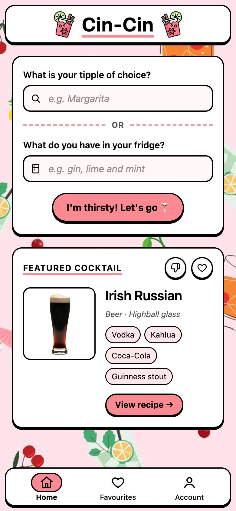
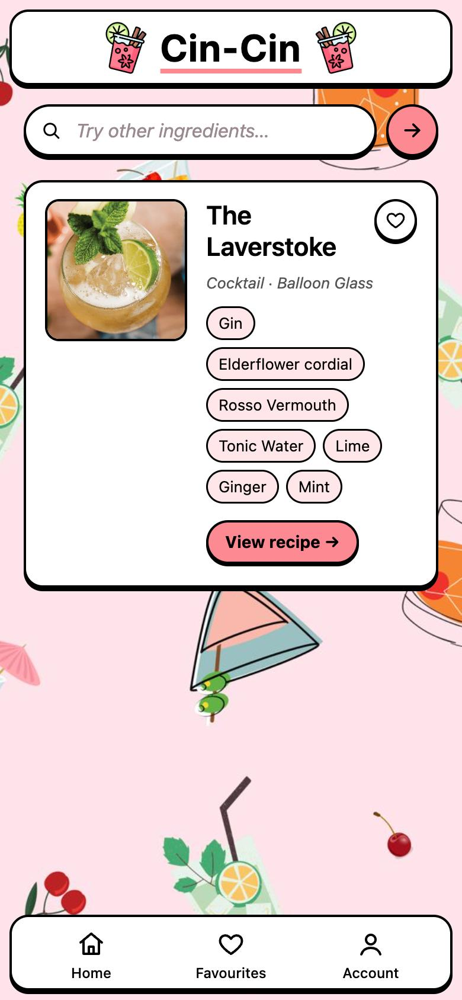
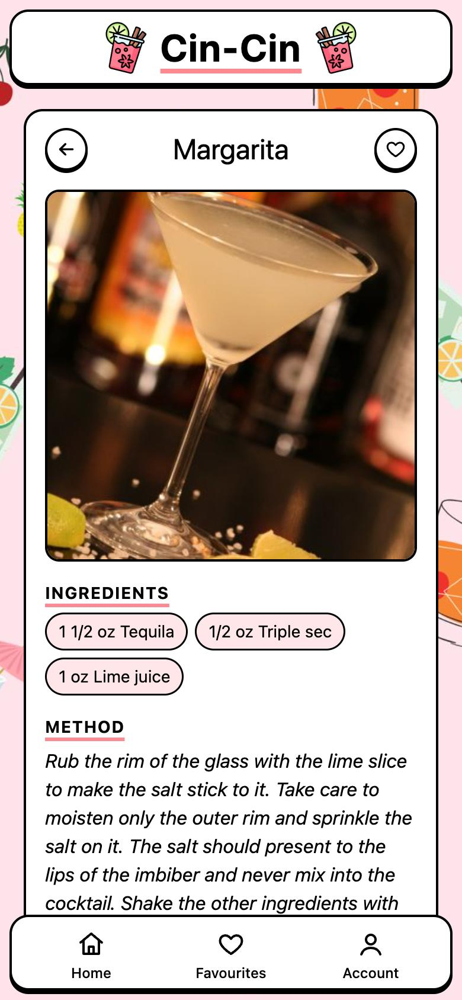
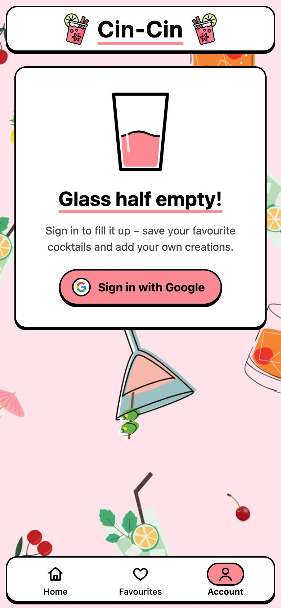

# Cin-Cin 🍸

**Find a cocktail you can make with what's already in your fridge.**

Cin-Cin is a mobile-first cocktail finder. Search for a drink by name, or type in the ingredients you have to hand and get recipes you can actually make. Sign in with Google to save favourites and keep a collection of your own cocktail creations.

**[Live demo → cincin-cocktail-app.vercel.app](https://cincin-cocktail-app.vercel.app)**

<p align="center">
  
  
  
  
</p>

## Features

- **Fridge search.** Type ingredients however you like – `gin lime and mint`, `Gin, Limes, Mint`, `oj + vodka` – and they're matched against TheCocktailDB's ingredient list, including plurals and common nicknames.
- **Search by name.** Look up any drink, with friendly suggestions when nothing matches.
- **Featured cocktail.** A random drink on the home page; give it a thumbs down to see another.
- **Favourites.** Save drinks with one tap. Updates are optimistic, so the heart responds instantly, and a favourite tapped while signed out is saved automatically after sign-in.
- **My Cocktails.** Add your own recipes with a live preview, and delete them with a two-step confirm.
- **Google sign-in.** Every user's favourites and cocktails are private to them.
- **Themed error pages.** Custom 404, 500 and empty states that stay on brand.
- **An easter egg.** Somewhere in the background… 🍒

## Tech stack

| Area | Tools |
| --- | --- |
| Framework | [Next.js 15](https://nextjs.org/) (Pages Router), React 18 |
| Data fetching | [SWR](https://swr.vercel.app/) with optimistic updates |
| Auth | [NextAuth.js](https://next-auth.js.org/) with Google OAuth, JWT sessions |
| Database | MongoDB Atlas with Mongoose |
| Styling | CSS Modules and Tailwind CSS |
| Data | [TheCocktailDB API](https://www.thecocktaildb.com/api.php) |
| Hosting | Vercel |

## Technical highlights

- **Server-side ownership checks.** API routes read the user from the session on the server and never trust a user id sent by the browser, so nobody can read or delete someone else's data.
- **Ingredient parsing** (`lib/formatIngredients.js`). Splits free text on commas, `and`, `+` and spaces, then greedily matches the longest known ingredient name so multi-word ingredients like "tonic water" stay together.
- **Fast favourites.** Adding a favourite is a single database upsert, which also stops double taps creating duplicates, and the UI updates before the server replies, rolling back on error.
- **Responsive and touch-friendly.** Designed for phones first, with hover effects only on devices that support hover.

## Running locally

You'll need Node.js, a MongoDB database (a free [Atlas](https://www.mongodb.com/atlas) cluster works) and a [Google OAuth client](https://console.cloud.google.com/apis/credentials).

1. Install dependencies:

   ```bash
   npm install
   ```

2. Create `.env.local` in the project root:

   ```bash
   MONGODB_URI=your-mongodb-connection-string
   GOOGLE_CLIENT_ID=your-google-client-id
   GOOGLE_CLIENT_SECRET=your-google-client-secret
   NEXTAUTH_SECRET=any-long-random-string
   NEXTAUTH_URL=http://localhost:3000
   ```

   In your Google OAuth client, add `http://localhost:3000/api/auth/callback/google` as an authorised redirect URI.

3. Start the development server:

   ```bash
   npm run dev
   ```

4. Open [http://localhost:3000](http://localhost:3000).

## Project structure

```
components/   UI components, each with its own CSS module
lib/          Helpers: ingredient parsing, auth checks, API lookups
db/           MongoDB connection and Mongoose models
pages/        Routes – pages/api holds the API routes
styles/       Global styles and page-level CSS modules
public/       Images and the background wallpaper
```

## Background

I built Cin-Cin as my final project at the Spiced Academy web development bootcamp in 2024, and later came back to it to modernise the design, tighten up security and improve performance.

Cocktail data and photos come from [TheCocktailDB](https://www.thecocktaildb.com/).
